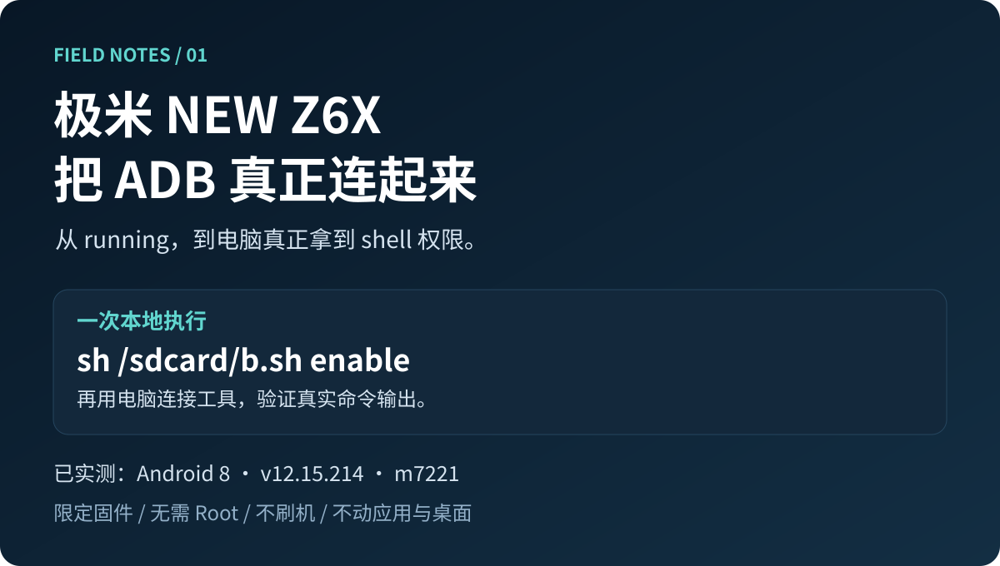
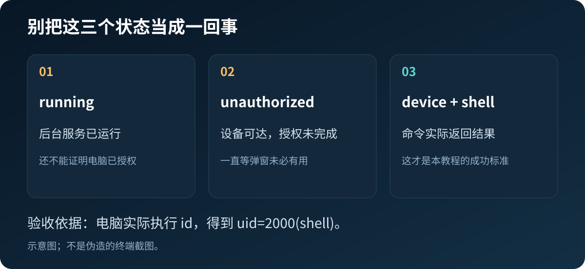

# 极米 NEW Z6X：把 ADB 真正连起来



没有开发者选项，工厂菜单只有两页，点“远程调试”又提示服务器繁忙。好不容易看见 `running`，电脑却仍然是 `unauthorized`。

这是我们在一台 **NEW Z6X / N111 / Android 8 / v12.15.214** 上实际排查、连接并重新验证的记录。配套工具把探索时的反复采集和长命令，整理成一次本地执行和一次电脑验证。

**先读 [完整图文教程](docs/tutorial.md)** · **原理见 [为什么最后连上了](docs/how-it-works.md)** · **结果见 [验证记录](evidence/validation.md)**

离线阅读：下载工具包，双击根目录 `index.html`。`docs/images` 同时提供 SVG 和 PNG 配图，方便图文发布。

> 只验证了下表中的设备与固件组合，不是全型号极米通用方案。脚本默认只检查，`enable` 会更改三个 ADB 相关属性并重启一次 Android 框架。它不刷机、不 Root、不删除应用，也不会把 SELinux 改为 Permissive。

| 项目 | 已验证值 |
|---|---|
| 商品型号 / 工厂型号 | NEW Z6X / N111 |
| Android / SDK | 8.0.0 / 26 |
| 硬件代号 | m7221 |
| 固件 | v12.15.214 |
| 系统指纹 | `Xgimi/ironman/ironman:8.0.0/OPR5.170623.014/v12.15.214:user/dev-keys` |
| 既有 SELinux 状态 | Permissive；这是本机原有状态，不是本教程操作 |
| 本地终端 | App Manager 4.1.1，普通应用身份 |

## 最短操作路线

1. 从 [Releases](https://github.com/Lpaipai/xgimi-adb-guide/releases) 下载教程工具包并解压；第三方工具从 [官方下载页](docs/downloads.md) 获取。
2. 在投影仪安装 App Manager，把 `scripts/b.sh` 复制到投影仪内部存储根目录，即 `/sdcard/b.sh`。
3. App Manager 首页右上角 **⋮ → 实验室 → 终端**。输入下方命令，按键盘“完成”或遥控器确认键执行：

   ```sh
   sh /sdcard/b.sh enable
   ```

4. 等投影仪回到桌面。在电脑上把官方 `platform-tools` 文件夹放进本教程目录，双击 **连接投影仪.cmd**，输入投影仪 Wi-Fi 详情里的 IP。
5. 只有工具显示“连接成功”，并返回 `uid=2000(shell)` 和设备指纹，才算完成。不要凭 `running` 或“没有报错”判断。



**网络边界：**这份厂商固件的授权实现会自动允许有效公钥，没有普通 Android 那样的确认弹窗。只在自己信任的局域网中使用，不做公网端口映射；不用时在投影仪本地终端执行 `sh /sdcard/b.sh off`。这不会清除以前保存的电脑授权。

## 文件说明

| 文件 | 用途 |
|---|---|
| `scripts/b.sh` | `check` 检查；`enable` 开启并重启框架一次；`off` 关闭；`restore` 恢复首次运行前保存的三个属性 |
| `连接投影仪.cmd` / `scripts/connect.ps1` | Windows 电脑连接与只读验收，使用独立服务端口 5047 |
| `docs/tutorial.md` | 面向普通用户的图文正文 |
| `docs/how-it-works.md` | 本机固件的机制与证据边界 |
| `docs/downloads.md` | 官方工具下载链接、APK 校验值 |
| `tests/test_script.py` | 18 个隔离模拟用例，无需投影仪 |
| `evidence/` | 脱敏后的验证记录，不包含密钥、账号或完整系统导出 |

电脑工具会在教程目录 `.runtime` 中创建密钥与运行日志，不修改系统 PATH 或持久执行策略。**不要分享 `.runtime`。** 教程不包含 APK、平台工具二进制或厂商系统文件；使用它们时遵守各自项目许可。

## 验证与局限

- 2026-10-21：原始流程连接成功，实际获得 `uid=2000(shell)`。
- 2026-10-22：整理后的脚本由普通应用 UID 执行，从 `adbd=stopped`、USB 配置为 `none`、端口为 `-1` 的状态成功开启；新生成的电脑密钥也连接成功。
- 18 个模拟用例通过。模拟检查与实机检查分别记录。
- 从未初始化的全新机器、其他系统版本、恢复出厂后首次连接，尚未验证。
- 本机整机重新开机后已复连成功，无需重跑开启脚本；本机已有持久端口配置，不能推断其他初始状态。关闭、恢复与重启的具体边界见 [验证记录](evidence/validation.md)。

不需要为此恢复出厂、重复导出 1GB 系统文件、遍历隐藏活动或反编译 APK。那些是定位原因时用过的研究步骤。

## 出错时

先查 [排错表](docs/tutorial.md#常见问题)。提交 Issue 时提供型号、固件、命令输出中的 STOP 信息即可；请遮掉 IP、序列号、MAC、账号等个人信息，不要上传密钥或整份系统备份。

本仓库原创脚本和文字采用 [MIT 许可](LICENSE)。界面截图、第三方软件名称及图标归各自权利人所有。作者：liaoweipeng1；GitHub：Lpaipai。
