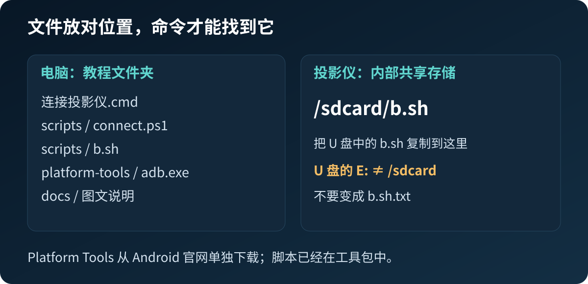
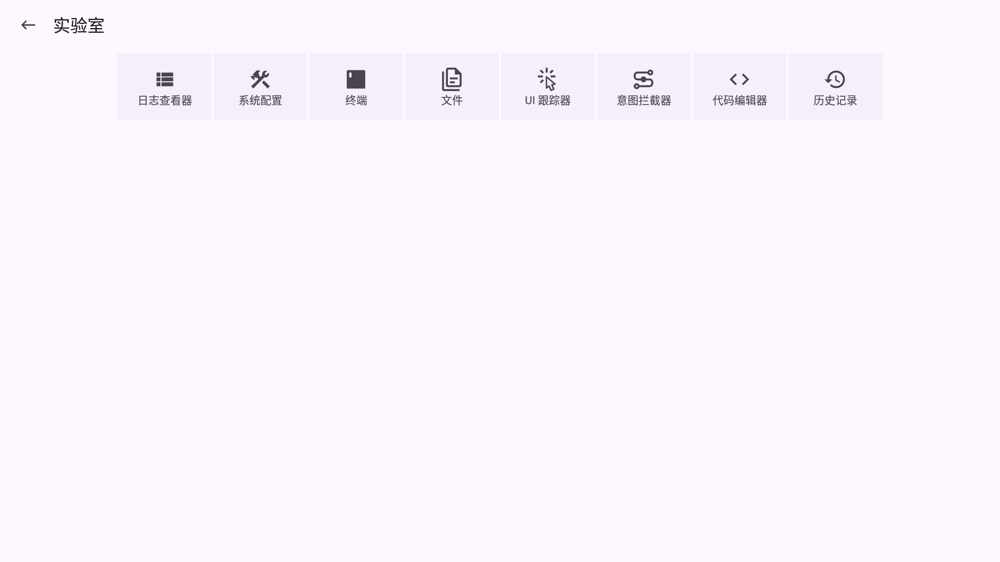
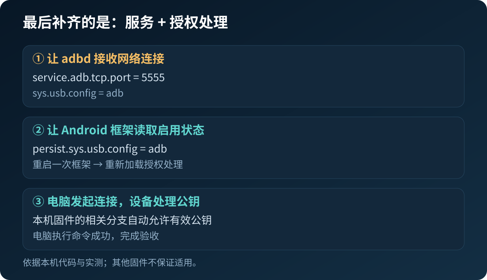
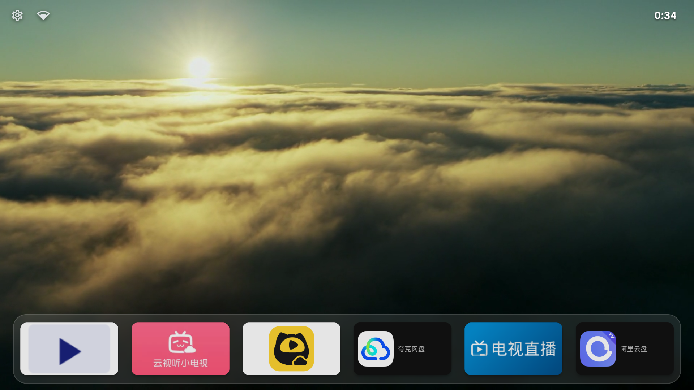

# 没有开发者选项，也没有授权弹窗：极米 NEW Z6X 连接 ADB 图文实战


我们最初只是想把投影仪的桌面整理得干净一点。结果卡在了第一步：电脑连不上投影仪。

找工厂菜单、安装活动启动器、点远程诊断、导出系统文件……最后虽然连接成功，却很容易误以为“是某次重启碰巧好了”。真正起作用的步骤可以整理得很短：**打开 ADB 服务、让系统重新加载授权开关，再由电脑实际验证。**

这篇把有效步骤和走过的弯路分开。你不需要重走我们的研究过程。

## 1. 先确认是不是同一版本

本教程实测：**极米 NEW Z6X，工厂型号 N111，Android 8.0.0，系统 v12.15.214，硬件 m7221。**

在投影仪的系统信息页核对型号和版本；菜单名称可能随系统界面变化。配套脚本还会读取完整系统指纹进行检查。只有商品名相同不够：如果出现 `Firmware not tested` 或 `Unsupported hardware`，就停止，不要删除检查条件硬跑。

我们这台机器原有 SELinux 状态是 Permissive，且普通应用发出的相关属性修改被系统接受。**这不是所有 Android 设备都有的能力；本教程不关闭安全机制来强行适配。**

## 2. 准备四样东西

- Windows 电脑，与投影仪处在同一可信局域网；避免有设备隔离的访客 Wi-Fi。
- U 盘，用于把安装包和脚本送进投影仪。
- App Manager 4.1.1：提供本地终端和文件管理器。
- 官方 Android SDK Platform Tools：电脑端的 ADB 工具。

打开 [下载与校验清单](downloads.md)。App Manager 选择后缀为 **`.apk`** 的单文件安装包，不要把 `.apks` 当成普通 APK。

解压教程工具包后，电脑端目录应类似下图。`platform-tools` 来自 Android 官网，单独解压后放进去。



U 盘只需要放 App Manager 安装包和 `scripts/b.sh`。**U 盘在电脑上的 E:，不是投影仪的 `/sdcard`。**

## 3. 安装 App Manager，把脚本放进内部存储

1. 将 U 盘插入投影仪，打开系统文件管理器，找到安装包。
2. 如果本机文件管理器隐藏 `.apk`，可将下载的 `AppManager_v4.1.1.apk` 改名为 `AppManager_v4.1.1.apk1` 再识别、安装。这是本次设备使用过的办法；改后缀不改变 APK 内容，也不是给 APK 加权限。
3. 打开 App Manager，按提示授予它访问文件所需的权限。**不需要先开启 Root 或 ADB 模式。**
4. 将 U 盘里的 `b.sh` 复制到投影仪的“内部共享存储”根目录。可以用现有文件管理器，或 App Manager 的 **⋮ → 实验室 → 文件**。目标应能以 `/sdcard/b.sh` 访问，不是 U 盘根目录，也不是 Download 子目录。

文件名必须是 `b.sh`，不是 `b.sh.txt`。如果你决定放在 Download，则后面的命令也必须改成实际路径，注意大小写；为了少敲字，本文统一放在内部存储根目录。

## 4. 找到终端，只执行一次开启

App Manager **首页右上角 ⋮ → 实验室 → 终端**。



图中从左往右第三个是“终端”；右边的“文件”可用于复制脚本。不要进入某个应用详情页的“在 Termux 中运行”，那不是本教程使用的入口。

输入：

```sh
sh /sdcard/b.sh enable
```

`sh` 后面有一个空格。点屏幕键盘的 **完成**；若收起键盘后焦点在命令输入框，可按遥控器确认键。确认命令出现在上方输出区，才代表已经执行，仅留在底部输入框不算。

脚本会核对型号和版本，保存三个原属性，再尝试开启 ADB。成功进入重启步骤时会显示：

```text
Restarting Android framework ONCE. Screen/network may disconnect briefly.
Wait for home screen, then check from PC.
```

此时等待桌面回来。它重启的是 Android 框架，应用会退出、网络可能短暂断开；不是刷机，也不是让你拔掉电源。

**看到 STOP 就停下，按报错排查。** 脚本有一次性标记，防止误点造成重复重启。不要反复运行，也不要删除标记去强制尝试。

终端启动时的 `can't find: tty fd`、`won't have full job control` 是我们现场也见过的提示，不能仅凭这两行认定脚本失败；应看后面的实际执行结果。

## 5. 找到投影仪 IP，交给电脑验证

打开投影仪的 Wi-Fi 详情，记下 **IP 地址**。不要抄“默认网关”或“DNS 服务器”。IP 可能在重启或重新联网后改变。

电脑上双击教程文件夹的 **连接投影仪.cmd**，输入刚才的 IP。工具会连接投影仪的 `5555` 端口，并实际执行 `id` 和固件查询。

成功输出应包含：

```text
连接成功：已实际执行设备端命令。
uid=2000(shell) ...
Xgimi/ironman/ironman:8.0.0/OPR5.170623.014/v12.15.214:user/dev-keys
```

这是 shell 权限，不是 Root。电脑工具不安装应用、不删除内容，也不调整桌面。


手动使用 ADB 的读者，可在 `platform-tools` 目录打开 PowerShell。以下 `192.168.1.50` 仅为示例，换成自己的 IP：

```powershell
.\adb.exe -P 5047 connect 192.168.1.50:5555
.\adb.exe -P 5047 -s 192.168.1.50:5555 get-state
.\adb.exe -P 5047 -s 192.168.1.50:5555 shell id
```

这里 `5047` 是电脑端 ADB 服务的端口，`5555` 是投影仪端口，两者作用不同。使用配套工具后继续手动操作时，也应使用同一个电脑端端口。不要为了排错随意执行全局 `kill-server`，以免影响别的手机或开发任务。

## 6. 最后到底补上了什么

可以把连接过程理解为两件事：

- **ADB 后台服务负责接收连接。** 它运行后，设备可能已经能被发现。
- **Android 框架负责处理电脑授权。** 这部分也必须处于启用状态。

我们先前只启动了第一部分，于是看见 `running`，电脑却停在 `unauthorized`。最后的脚本设置了 `service.adb.tcp.port=5555`、`persist.sys.usb.config=adb`、`sys.usb.config=adb`，再重启一次框架，让系统重新读取启动配置。



本机厂商代码在收到有效电脑公钥后，直接进入允许调试的处理分支。**因此没有授权弹窗，不代表你漏点了。** 这也意味着只能在可信局域网使用，不应把 5555 端口暴露到公网。

这些是本机代码与实测结果共同支持的解释，不是对所有极米固件的保证。[更详细的原理和证据边界](how-it-works.md)。

## 7. 这些弯路可以省掉

| 我们试过什么 | 这台机器上的结论 |
|---|---|
| 工厂菜单翻页找 ADB | 两页菜单里没有找到可用开关，无需触碰校准项目 |
| RemoteDebug 的“开启远程调试” | 分析得到的是依赖厂商服务器的 SSH 诊断通道，不能当成本地 ADB 开关 |
| 一直等授权弹窗 | 该固件的相关代码分支自动允许；此前更关键的是授权处理未启用 |
| 任意带 Debug 名字的活动 | 有些是私有组件，普通应用启动会被拒绝；名字不能证明用途 |
| 普通终端直接写全局设置 | 遇到权限检查，不能用来替代已经验证的属性流程 |
| 反复导出系统文件 | 是研究过程，照本教程操作不需要采集那些文件 |

## 常见问题

| 看到的现象 | 先做什么 |
|---|---|
| `sh/sdcard/...: not found` | `sh` 后漏了空格，正确形式为 `sh /sdcard/b.sh enable` |
| `can't open ...` / `No such file` | 核对文件确实在投影仪内部存储根目录，且不是 `.sh.txt` |
| 命令一直在底部输入框 | 还未执行，点键盘“完成”或收起后用遥控器确认 |
| `Firmware not tested` | 版本不符，停止；不要移除保护检查 |
| `Expected existing Permissive state` | 本机条件不同，不要为使用教程而改 SELinux |
| `Property rejected` | 此设备没有接受属性修改；查看 action.log，不盲试 Root 或刷机 |
| `Already attempted` | 已请求过一次框架重启，先用电脑验证；不要删除标记循环运行 |
| 连接超时／被拒绝 | 核对投影仪开机、IP、同一局域网、访客网络隔离和 adbd 状态 |
| `unauthorized` | 后台可达但授权未完成；核对脚本是否完成框架重启，而非只看 running |
| 电脑端端口被占用 | 换一个独立 ServerPort；不要停止别人的 ADB 服务 |
| 整机重启后无法连接 | 先看开机与 Wi-Fi 状态、重新核对 IP；不要把重跑一次性脚本作为第一步 |

## 8. 用完关闭，保留恢复办法

在投影仪 **本地终端**执行：

```sh
sh /sdcard/b.sh off
```

这会把当前和持久 USB 配置设为 `none`，网络端口设为 `-1`，并检查 adbd 是否停止。电脑 ADB 会断开，属于预期行为。**关闭服务不会删除已经保存的电脑授权。**

首次 `enable` 前的三个属性保存在 `/sdcard/xgimi-adb-guide/original`。需要恢复这三个原值时，在本地终端执行：

```sh
sh /sdcard/b.sh restore
```

`restore` 只恢复保存的属性，不是恢复出厂；原来若已开着 ADB，恢复后也可能仍开着。它不重启框架，因此不能把属性恢复等同于“框架内存状态与最初完全相同”。脚本的 `off`、`restore` 实机检查范围见 [验证记录](../evidence/validation.md)。

脚本日志位于 `/sdcard/xgimi-adb-guide/action.log`，一次性标记为 `restart.once`。保留这些记录，遇到问题时只分享必要片段并脱敏。

## 9. 下一步再做桌面与应用整理

ADB 连通后，才有条件方便地安装应用、截图和整理桌面。系统精简、替换桌面、直播软件是另外的操作，不应塞进开启 ADB 的脚本。



上图是本机后续配置效果，不是运行本教程脚本就会自动得到的桌面。我们把“建立可靠连接”作为本期终点。

资料与边界：[官方下载](downloads.md) · [机制说明](how-it-works.md) · [实测记录](../evidence/validation.md) · [Android 官方 ADB 文档](https://developer.android.com/tools/adb)
